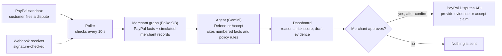

# DisputeDesk

An AI agent that decides whether to defend or settle PayPal disputes.
The agent recommends; nothing is sent to PayPal until the merchant approves. Autopilot preview never sends anything. Autopilot preview never sends anything.
This repository only proves that the real PayPal sandbox dispute flow works.

## How it works

1. A customer files a dispute in the PayPal sandbox.
2. DisputeDesk detects it by polling the Disputes API every 10 seconds, and a signature-checked webhook
   receiver feeds the same pipeline.
3. A merchant graph (FalkorDB) turns PayPal's records and the merchant's shipment and device records into
   numbered facts F1, F2 and so on.
4. The agent recommends Defend or Accept with a risk score and reasons that cite those facts and the
   policy rules P1 to P4.
5. The merchant approves: a dry run shows the exact request, a confirmation names the action and amount,
   and only then is anything sent to PayPal.

The agent recommends; nothing is sent to PayPal until the merchant approves. Autopilot preview never sends anything.



## Quick start: demo mode (no accounts, no keys)

Needs Python 3.12 and git. Demo mode serves recorded sandbox data from `data/demo_snapshot.json`; it
makes no PayPal, Gemini or FalkorDB calls and every write (including Approve) is disabled.

Windows Command Prompt or PowerShell (the commands are the same in both):

```
git clone https://github.com/codingwinterz/Dispute-Desk.git
cd Dispute-Desk
py -3.12 -m venv .venv
.venv\Scripts\python -m pip install -r requirements.txt
.venv\Scripts\python scripts/demo.py
```

Then open http://127.0.0.1:8000/ (the Overview; the queue is at http://127.0.0.1:8000/queue). (macOS/Linux: `python3.12 -m venv .venv`, then `.venv/bin/python`.)
If port 8000 is in use, run `scripts/demo.py --port 8010` and open that port instead.
The top bar shows **Demo data**. The snapshot includes one simulated carrier event on the YOV dispute, labelled as a
recorded, simulated merchant event. Buyer and account identifiers in the snapshot are anonymised placeholders.

## Full mode (your own PayPal sandbox)

Needs Python 3.12, Docker, a PayPal sandbox REST app and a Gemini API key. Judges and reviewers use
their own sandbox keys; nothing in this repository is a live credential.

```sh
copy .env.example .env                                # fill in the four values (cp on macOS/Linux)
docker compose up -d falkordb                         # graph database on 127.0.0.1:6379
.venv\Scripts\python scripts/import_merchant_records.py --file seed/merchant_data.json   # after the first disputes arrive
.venv\Scripts\python scripts/start.py                 # checks the setup, then starts the app
```

`scripts/start.py` checks the Python version, dependencies, `.env` (present, UTF-8, parseable, all four
keys set) and FalkorDB, and prints each problem with the command that fixes it instead of a stack
trace. Open disputes in the sandbox as described in *Running the sandbox check* below; the poller
picks them up within `POLL_SECONDS`.

### Sandbox limits

- **Detection is by polling.** No dispute webhook was observed in the sandbox (`CUSTOMER.DISPUTE.*`), so
  the poller (`GET /v1/customer/disputes`) is the primary detector; the webhook receiver stays on as
  a second source.
- **No partial offers.** Offers (`make-offer`) are only accepted while a dispute is in the inquiry stage.
  Most recorded disputes are at the chargeback stage; two (PP-R-CTG-10197156 and PP-R-WZR-10197157) are
  at the inquiry stage. Offers are not built, so the choices are to provide evidence or accept the claim.
- **Disputes are opened by hand.** Creating one through the API needs a scope only a PayPal account
  manager can grant.
- **Shipments and devices are simulated** (see below); in production your store supplies them.

## What is real and what is simulated

| Part | Status |
|---|---|
| Disputes, statuses and deadlines | Real: PayPal sandbox Disputes API |
| Detection | Real: polling every 10 seconds |
| Webhook receiver | Built and signature-checked. No dispute webhook was observed in the sandbox |
| Graph queries, Gemini decision step, policy rules | Real: run live on the data below |
| Defend | Verified live on one dispute: PayPal accepted the evidence and moved it to UNDER_REVIEW. No outcome observed |
| Accept | Verified live on one dispute: the buyer was refunded and the dispute reached RESOLVED |
| Shipment, device, IP and earlier-dispute records | Simulated merchant data, tagged "seeded" |
| Carrier-scan merchant events | Simulated |
| Demo snapshot | Recorded and anonymised; it includes one simulated carrier event on the YOV dispute |
| Buyer attachments | Live mode only, where PayPal provides a download link; never analysed by the agent |
| Partial offers; reading attachment contents | Not built |

Sandbox only. There are no live credentials and no live base URL anywhere in this code.

## Scripts

- **Scratch mode:** `python scripts/scratch.py create` (or `reset`) copies the store to `data/scratch.db` and seeds the graph `disputedesk_scratch`; set `DISPUTEDESK_DB` and `DISPUTEDESK_GRAPH` in the shell (never in `.env`) to use it, and the top bar shows **Scratch data**.
- **`GET /api/poller`:** read-only, local-only poller status (last poll, disputes returned, new IDs, next poll, errors) behind the top-bar polling chip; demo mode answers "Recorded data, polling disabled".
- **`python scripts/export_demo.py --exclude <dispute_id>`:** leaves a dispute out of everything in the demo snapshot (repeatable); an unknown ID writes nothing.
- **`python scripts/probe_attachment.py <dispute_id>`:** one read-only GET of a stored attachment link, after an https `api-m.sandbox.paypal.com` host check and with redirects off; prints only the status, redirect host, content type, byte count and detected file type.

## Layout

- `disputedesk/auth.py`: OAuth client-credentials token with caching
- `disputedesk/webhooks.py`: FastAPI receiver `POST /webhooks/paypal`
- `disputedesk/disputes.py`: Disputes API client
- `disputedesk/poller.py`: background poller started with the app (read-only GETs)
- `disputedesk/dispute_store.py`: SQLite store of processed dispute IDs, shared by poller and webhook
- `disputedesk/events.py`: in-process `dispute_detected` and `dispute_updated` events
- `disputedesk/graph.py`: FalkorDB graph store and the one-query dispute context
- `disputedesk/seed.py`, `seed/merchant_data.json`: seeded merchant context
- `disputedesk/policies.py`: merchant policy settings (SQLite) and the rules P1–P4 built from them
- `disputedesk/drafts.py`: merchant-edited evidence drafts (SQLite)
- `disputedesk/submissions.py`: approved responses to PayPal (the only PayPal writes) and their records
- `disputedesk/decision.py`: LiteLLM decision step with schema validation and citation checks
- `disputedesk/decision_store.py`: SQLite store of decisions
- `disputedesk/analyzer.py`: worker thread that runs decisions automatically
- `disputedesk/autopilot.py`: shadow-only Autopilot preview state machine, runner, circuit breaker, and audit log
- `scripts/sandbox_check.py`: step-by-step check against the real sandbox (not part of pytest)
- `scripts/preflight.py`: read-only environment check (.env, FalkorDB, sandbox-only URL)
- `scripts/seed_graph.py`, `scripts/analyze.py`: seed the graph; run decisions from the CLI
- `tests/`: unit tests with mocked HTTP

## Setup details

Python 3.12 (LiteLLM's native dependencies have no wheels for 3.15 yet). FalkorDB runs from
`docker-compose.yml` (`falkordb/falkordb:6.0.3`, bound to 127.0.0.1). Run the tests with
`.venv\Scripts\python -m pytest -q`; they mock every PayPal, Gemini and FalkorDB call.

To refresh the demo snapshot from your own local store: `.venv\Scripts\python scripts/export_demo.py`.
It keeps only what the dashboard shows, pseudonymises identifiers and refuses to write the file if an
email, original identifier or token-like string would remain.

## Running the sandbox check

1. Start the receiver: `.venv/Scripts/python -m uvicorn --factory disputedesk.webhooks:create_app --port 8000`
2. Expose it: `ngrok http 8000`
3. In the developer dashboard, add a webhook to your sandbox app pointing at
   `https://<ngrok-host>/webhooks/paypal` and subscribe to `CUSTOMER.DISPUTE.*`.
   Put its ID in `PAYPAL_WEBHOOK_ID` and restart the receiver.
4. As the **sandbox personal (buyer)** account, pay the **sandbox business** account,
   then open disputes on those payments at sandbox.paypal.com (Resolution Center).
5. Run `.venv/Scripts/python scripts/sandbox_check.py --inquiry-dispute-id PP-D-... [--claim-dispute-id PP-D-...]`
   (read-only: `--list` lists disputes; `--dispute-id PP-D-...` shows one dispute's details with a single GET and no mutating calls)

Logs (raw requests/responses with secrets redacted, plus webhook events) go to `logs/`, which is git-ignored.

## Dispute polling

Polling is the primary detector: no dispute webhook was observed in the sandbox. The webhook
receiver stays on as a second source.

The receiver app polls `GET /v1/customer/disputes` every `POLL_SECONDS` (default 10) and follows
`next` pages. For each dispute ID it has not seen, it fetches `GET /v1/customer/disputes/{id}`,
saves the JSON to `logs/disputes/<id>.json` and emits `dispute_detected` with `source="poll"`.
Dispute webhooks emit the same event with `source="webhook"`.

- Both paths share `data/disputedesk.db` (SQLite, git-ignored). Claiming a dispute is one atomic
  insert, so each dispute is emitted once, by whichever path sees it first, even if both see it at
  the same moment. If the webhook got there first, the next poll stores the full dispute
  without emitting a second event.
- A 401 refreshes the token and retries once. 429s (honouring `Retry-After`), 5xx responses and
  network errors back off exponentially, capped at 300s. The loop never stops on an error.
- Every poll logs `poll ok count=<items> new=<unseen ids> changed=<refreshed ids>`.
- Disputes already stored are refreshed when the list shows a different `status`,
  `dispute_life_cycle_stage`, `update_time` or set of links: the poller GETs that dispute again,
  stores it and emits `dispute_updated`. Unchanged disputes cost no extra request.
- The poller only sends GETs. No code path calls provide-evidence, accept-claim, make-offer,
  escalate or adjudicate.

`GET /api/disputes` returns the stored disputes as JSON: id, status, stage, reason, amount, due
date, `source` (always `paypal`), `detected_via` (`poll` or `webhook`), detected_at, action link
names, and the agent's decision summary (or `null` while analysis is pending).
`GET /api/decisions/{id}` returns one dispute with its full decision: reasoning, cited facts, draft
evidence and the graph snapshot. Neither makes a PayPal call.

Only `POST /webhooks/paypal` is public. Every other route (dashboard, static files, `/api/*`)
refuses requests that came through the ngrok tunnel (those carry `X-Forwarded-For`).

## Dashboard

Open http://127.0.0.1:8000/ while the app runs (local only; no build step, plain HTML/JS/CSS served
by FastAPI, AG Grid Community from a CDN). The Overview is the start page; the old `/overview` link
redirects there.

- **Overview** (`/`): the next response deadline, counts (open disputes, amount in open
  disputes per currency, due within 72 hours, without a recommendation) and the open disputes in the
  order to answer them.
- **Activity** (`/activity`): a timeline of what happened to each dispute (detected, analyzed, draft
  edited, approved, PayPal's answer), built from the existing read-only API.
- **Insights** (`/insights`): recommendation split, risk-score bands, disputes by reason and open
  disputes by deadline, all counted from the local store.
- **Merchant records** (`/merchant-records`): the shipments and checkout devices behind each disputed
  transaction and earlier disputes on file, each with its source tag. Import them from a JSON file with
  `scripts/import_merchant_records.py --file <file>`: it validates the file (one line per problem),
  takes real transaction IDs from the stored PayPal disputes, stores the records for this page and seeds
  the graph from the same file (`--no-graph` to skip). A new import replaces the previous one.
- **Queue** (`/queue`): every stored dispute with a live countdown to the seller response deadline (red
  under 72 hours), status, recommended action, risk score and source. Search, reason and status
  filters; refreshes every 5 seconds and flashes cells that changed.
- **Case** (`/case/{id}`): the recommendation, risk score, reasoning with the facts it cites, the draft
  response, and the graph path behind it with the cited nodes highlighted, in 3D (three.js 0.160.0 from
  cdnjs) or as a flat diagram when WebGL is missing or reduced motion is on. Seeded records carry a
  visible `seeded` tag, plus the approval panel described below.
- **Policies** (`/policies`): switch rules P1–P4 on or off and set their thresholds (accept under a
  dollar amount; how many other disputes must share a device or IP). The page shows the exact rule
  text the agent reads, built by the server. Saved policies apply to the next analysis; each decision
  stores the rules it was made under, and the case page shows the rules it cited.

**Ask about this case** (case page, live mode only; hidden in demo mode): a read-only question box
answered only from the case's numbered facts. The server sends the LLM the question and the facts
(`F1`…) already stored with the decision, nothing else: no buyer messages, no attachment names, no
policy rules, no drafts. The reply must cite supplied fact IDs; an unknown ID, a missing citation or a
forbidden word fails validation, which is retried once and then reported as an error. It calls no tools
and writes nothing, to the store or to PayPal. Questions are capped at 500 characters and each LLM call
has a 30-second timeout. As in the decision step, the facts sent include the simulated shipment and
checkout-device records and the buyer's sandbox payer ID.

## Approving a response (PayPal writes)

The case page's approval panel is the only way the app writes to PayPal. Nothing is ever sent from the
poller, the webhook, the analyzer or app startup. Autopilot preview never sends anything.

- **What it sends.** DEFEND sends `POST /v1/customer/disputes/{id}/provide-evidence` as multipart
  form data with one `input` part: `{"evidences": [{"evidence_type": "OTHER", "notes": <saved draft>}]}`.
  No file is attached. ACCEPT sends `POST /v1/customer/disputes/{id}/accept-claim` with
  `{"note": "Accepting the claim: full refund to the buyer."}`, which closes the dispute in the buyer's
  favour and refunds the buyer. Sources: PayPal's Use Disputes API guide and the Disputes v1 spec.
- **Notes-only evidence.** PayPal's docs don't show a notes-only evidence submission (their sample attaches
  a file), so the page marks it as unverified until the first one succeeds; that success is recorded and
  the notice goes.
- **Dry run.** "Show the exact request" builds the request from stored state, with the token
  redacted, and sends nothing (`GET /api/submissions/{id}/dry-run`).
- **Confirm.** Approve opens a dialog with the action, dispute ID, amount and the exact text PayPal will
  receive. Only confirming calls `POST /api/submissions/{id}`, which needs `confirm: true` and the same
  action and text the dialog showed.
- **Checks before sending.** A recommendation exists and matches the action; the draft is within
  PayPal's 2000-character notes limit and starts with the sandbox sentence; a fresh read from PayPal
  shows `WAITING_FOR_SELLER_RESPONSE` and the action's link.
- **One submit per dispute.** The attempt is recorded before sending. A second submit is blocked unless
  PayPal definitely refused the last one (HTTP 4xx). A network error or 5xx leaves the outcome unknown,
  so it stays blocked; check the dispute in the PayPal sandbox.
- **Logs.** Every write and its response go to `logs/submit_http.jsonl`, with the token redacted.

Each submission is irreversible in the sandbox, so testing again needs new sandbox disputes.

The draft response on the case page is editable. A saved draft is kept apart from the agent's
decision (re-running the agent never overwrites it) and is the text an approval sends. Saving
refuses a draft over 2000 characters or one that doesn't start with the sentence saying shipment and
device records are sandbox test data. Once a response is sent, the draft can't change.

Writes (`PUT /api/policies`, `PUT /api/drafts/{id}`, `POST /api/policies/preview`,
`POST /api/submissions/{id}`) accept JSON only, from this app's own pages (a foreign `Origin` is
refused), and like every non-webhook route are local-only. Only `POST /api/submissions/{id}` calls
PayPal.

```sh
# run the app (webhook receiver + poller + analyzer + dashboard); optional: POLL_SECONDS=30 in .env
.venv/Scripts/python -m uvicorn --factory disputedesk.webhooks:create_app --port 8000
# in another terminal
curl http://127.0.0.1:8000/api/disputes
```

## Decision agent

For each dispute with full details, the agent decides **DEFEND** or **ACCEPT**:

1. The dispute is merged into the FalkorDB graph (`Customer -INITIATED-> Transaction -HAS_DISPUTE-> Dispute`,
   plus seeded `FULFILLED_BY -> Shipment` and `LOGGED_FROM -> Telemetry`).
2. One Cypher query returns the buyer, transaction, shipment, telemetry, and other disputes whose
   transaction shares the checkout device hash or IP.
3. That result becomes numbered facts (`F1`…), each tagged `paypal` or `seeded`. The LLM (LiteLLM,
   model `LLM_MODEL`, default `gemini/gemini-3.5-flash-lite`) gets only those facts and the policy rules
   (`P1`…P4), and returns JSON: decision, risk_score (likelihood 0–100 that the buyer's claim is
   valid, i.e. the merchant would lose if it defended, based only on the supplied facts: signed
   delivery 5–20, no carrier scan 70–90, linked disputes move it at most 15; a cost-only ACCEPT is
   still scored on the facts), 3–5 reasoning points and a draft evidence summary. Every draft starts
   with a note that shipment and device records are merchant-supplied sandbox test data; linked disputes are described only as
   sharing a device hash or IP, and a pattern is not proof.
4. The reply is validated. Every reasoning point must cite supplied IDs; an unknown ID or bad JSON
   or a forbidden word (fraud, abuse, abuser, ring) gets one retry, then the decision is stored as an
   error (and retried by the next sweep). A 429 or 503 from the LLM is retried up to 3 times with
   backoff (1s, 2s).
5. Decisions go to the `decisions` table in `data/disputedesk.db`.

The app runs this automatically: on `dispute_detected`, on `dispute_updated` (until a decision
exists), and in a sweep of stored disputes at startup. The work happens on one worker thread, so
the poller and webhook never wait for the LLM. No PayPal write call is made.

```sh
.venv/Scripts/python scripts/seed_graph.py --reset          # build the graph (no PayPal or LLM calls)
.venv/Scripts/python scripts/analyze.py --all --facts-only  # what the model would see (no LLM call)
.venv/Scripts/python scripts/analyze.py --all               # one LLM call per undecided dispute
```

Sandbox limit: every sandbox dispute here was opened by the same test buyer, so the graph links
disputes only through a shared device hash or IP, never through the buyer.

## Merchant events (simulated new evidence)

A merchant event is new evidence from the store's own systems, such as a late carrier scan. In
production your store supplies this; in the sandbox it is simulated from a small JSON file:

```bash
.venv/Scripts/python scripts/merchant_event.py --file seed/events/yov_delivery_scan.json
.venv/Scripts/python scripts/merchant_event.py --file seed/events/qqw_delivery_confirmation.json
```

The script finds the dispute from the event's `transaction_id` in the stored PayPal disputes and
rejects unknown transactions (nothing is written). It adds the event to the graph as
`source = "seeded"`, labelled "simulated merchant event", then re-runs that dispute's decision with
the analyzer (one LLM call). The new decision is stored and the one it replaces is kept in the
decision history. The case page shows "Merchant event received" in its timeline and, when the
event triggered the current decision, the verdict before and after. Each event can be imported once
(`event_id`); `--no-analyze` writes the event without re-deciding. No PayPal calls.

## Autopilot preview (shadow-only)

Autopilot preview (`Autopilot preview (never sends)`) is an opt-in shadow-only runner (`OFF` by default)
for small P2 claims. Autopilot preview never sends anything: every job stops after building the
dry-run request and writes `"Autopilot preview: would have accepted <dispute>. Nothing was sent."` to
the audit and Activity logs.

- **Eligibility:** only `CHARGEBACK`-stage disputes with an `ok` `ACCEPT` decision citing `P2` (and not `P3`), USD amount strictly under `$15` and under the P2 threshold, no linked disputes, no buyer documents or URLs, status `WAITING_FOR_SELLER_RESPONSE` with `accept_claim`, and no blocking submission.
- **Arming & 30-second cancel window:** armed only by analyzer decisions and poller `dispute_updated` events (never from any `GET`). Armed jobs enter a 30-second countdown (`Would accept in 30 s (preview only)`) that the merchant can cancel from Queue, Policies, or Case. Saving policies cancels all armed jobs.
- **Safety & recovery:** guarded SQLite state machine (`BEGIN IMMEDIATE` per transition), daily cap of `5` executions per UTC day, fresh read-only status re-check before building the dry run, `boot_id` restart recovery (marks prior `armed`/`executing` rows `stale`), circuit breaker (any exception trips `enabled = 0` and cancels armed jobs), and a top-bar kill switch on every page.
- **Demo & scratch modes:** blocked (`403`) on all `/api/autopilot*` routes and completely hidden in the UI.

## What's next

- **Autopilot live mode** — designed and not built (kept out of this shadow-only release; no live toggle, typed confirmation phrase, or live execution path exists).
